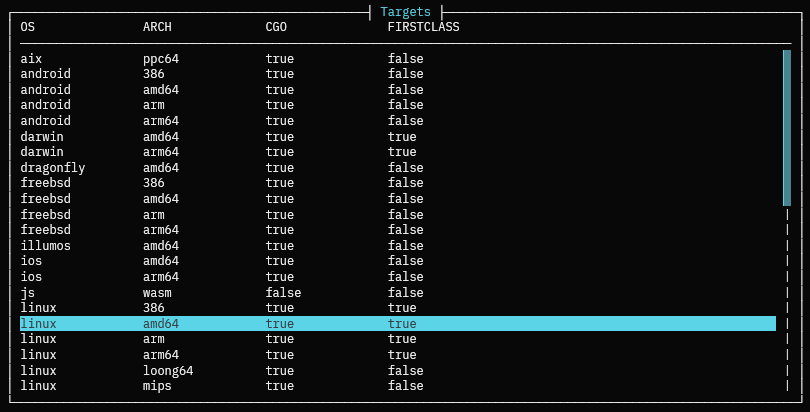

# gotarget
Go cross compile helper

## Quick start
```sh
gotarget -t              # select target, auto generates template 
gotarget -b <buildfile>  # builds template
gotarget -r              # release build (stripped) 
gotarget                 # debug build
```

Running gotarget without any arguments makes a debug build in the current directory.

## TUI
`gotarget -t` lists every target your Go toolchain supports. It is not hardcoded as it uses `go tool dist list -json` under the hood. \
Once you select a target and hit `Create Template`, it autogenerates a build file in the current directory.



## Build files
Generated templates look like this:

```toml

# Generated by gotarget
# Template for linux/amd64
# CGO Support: Yes
# First Class: Yes

[build.release]
cmd = "go"
args = ["build", "-ldflags", "-s -w", "-trimpath", "-o", "myapp"]

[build.release.envs]
CGO_ENABLED = "0"
GOOS = "linux"
GOARCH = "amd64"

```

Edit `args` and add more `envs` as needed. `cmd` can be any command, not just "go". \
To use a build file, specify it with `gotarget -b <BUILDFILE>`. \
Example:
```sh
# Assuming it is in the current directory.
gotarget -b gotarget_linux_amd64.toml
```

## Project templates
```sh
gotarget -B myapp   # binary project (myapp/main.go + go.mod)
gotarget -L mylib   # library project (mylib/pkg/lib/lib.go + mylib/go.mod)
```

## Options
```
Usage: gotarget [OPTIONS]

Options:
  -t, --tui            Start TUI
  -p, --path <PATH>    Path to project root [default: .]
  -r, --release        Build stripped binary
  -b, --build <BUILD>  Use a build file [default: ""]
  -B, --bin <BIN>      Create binary project template [default: ""]
  -L, --lib <LIB>      Create library project template [default: ""]
  -h, --help           Print help
  -V, --version        Print version
```
